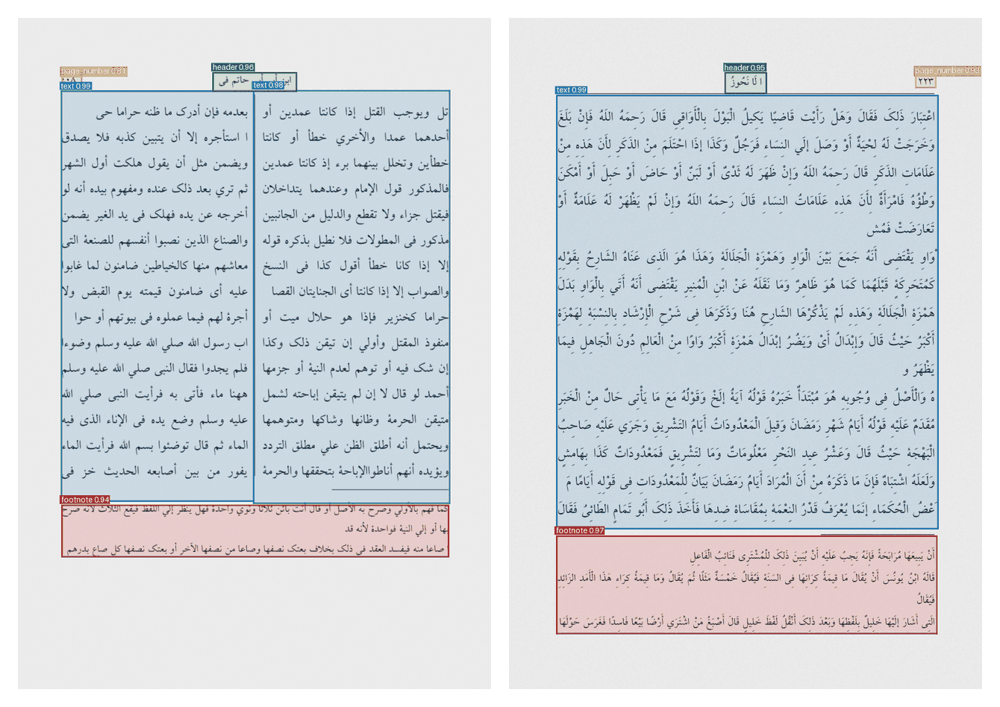

# ara-doc-layout

Arabic document page layout analyzer.



The model is based on PP-DocLayout_plus-L (RT-DETR-L on an HGNetV2 backbone),
fine-tuned on 12,000 synthetic and 1,352 hand-labelled real pages.

## What it finds

Nine classes:

| class | Description |
|---|---|
| `text` | body text, including headings and text columns |
| `footnote` | the footnote apparatus, as **one** block |
| `hashiya` | a gloss set in the margin beside the main text |
| `table` | a table, (with or without borders) |
| `caption` | the caption of a figure or plate |
| `header` | running head |
| `footer` | running foot |
| `page_number` | does this need explanation ? |
| `other` | figures, ornaments, stamps... |

## Benchmarks

TODO

## Install

With an NVIDIA GPU:

```bash
pip install "ara-doc-layout[gpu] @ git+https://github.com/g3ida/ara-doc-layout.git" \
    --extra-index-url https://www.paddlepaddle.org.cn/packages/stable/cu129/
```

On the CPU:

```bash
pip install "ara-doc-layout[cpu] @ git+https://github.com/g3ida/ara-doc-layout.git"
```

Without `[gpu]` or `[cpu]`, only the region geometry is installed (`Region`,
`reading_order`, `side_by_side`) and Paddle is not. That is enough for a
program that talks to the detector running in another environment.

- **The extra index:** Paddle's GPU wheels from 3.0 on are not on PyPI. They
  come from Paddle's own index, one per CUDA version. `cu129` is the build the
  numbers here were measured with; `cu118`, `cu126` and `cu130` carry the same
  3.3.1.
- **A virtualenv of its own:** Paddle pins numpy < 2 and brings its own CUDA
  libraries, which rarely sit well beside PyTorch.
- **The weights** (132 MB) are downloaded from the GitHub release on first use
  into `~/.cache/ara-doc-layout/`. They are checked against their SHA-256
  before use. To use a local copy, set `ARA_DOC_LAYOUT_WEIGHTS` to a
  `.pdparams` file.
- **PaddleDetection** is pinned to commit `65e6435`, the one the checkpoint
  was trained and measured with.

For development, from a clone:

```bash
pip install -e ".[gpu,test]" --extra-index-url https://www.paddlepaddle.org.cn/packages/stable/cu129/
```

## Use

### In Python

```python
from PIL import Image
from ara_doc_layout import Detector, reading_order, side_by_side

detector = Detector()                      # on the GPU if Paddle was built for one
page = Image.open("page.png")
regions = detector.detect(page)            # boxes in the image's own pixels

for region in reading_order(regions, page.width):
    print(region.kind, region.box, round(region.score, 2))

if side_by_side(regions):
    ...  # columns or a gloss beside the text: read region by region
```

- **What `detect` takes:** a path, a PIL image or an RGB array.
- **Resolution:** every page is squeezed to 800×800 on the way in, so
  rendering a PDF page past ~150 dpi buys nothing.
- **Points, not pixels:** to put the boxes in PDF points, use
  `region.scaled(72 / dpi)`.
- **The floor:** `score=` sets the minimum confidence, per detector or per
  call.

### From the command line

```bash
ara-doc-layout page-*.png --draw drawn/
```

Prints one JSON line per page: its size, its regions, and `reading_order`
(indices into `regions`). With `--draw`, each page is also written with its
regions outlined. Paddle's own chatter goes to stderr, so the output can be
piped.


## Speed

Measured on an RTX 5060 Laptop (8 GB) and a Core Ultra 9 275HX, with pages at
150 dpi:

| | load | per page (median) |
|---|---:|---:|
| GPU | 3.8 s | 48 ms |
| CPU (24 threads) | 4.1 s | 3.95 s |

## Licence

Apache-2.0, see [LICENSE](LICENSE). The base model (PP-DocLayout_plus-L) and
PaddleDetection are Apache-2.0 as well.